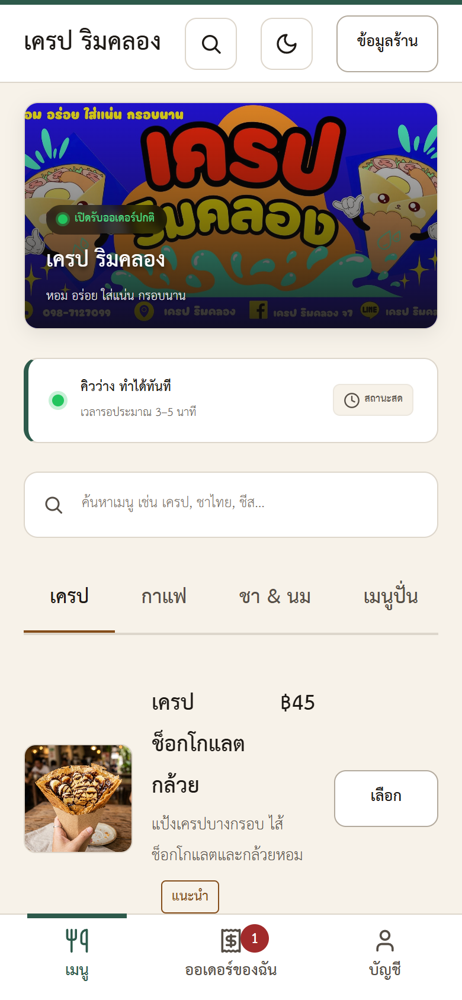
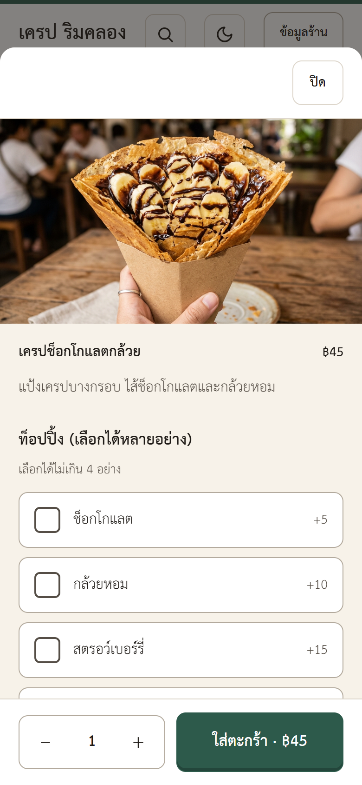
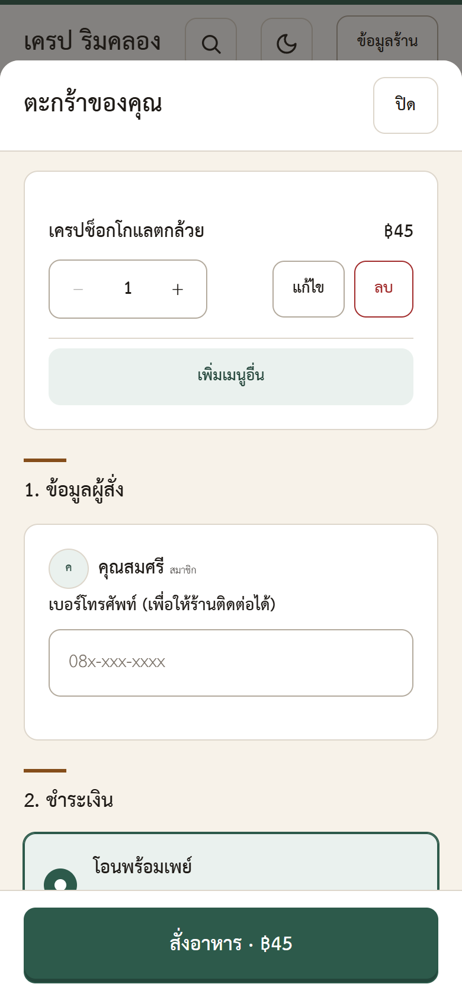
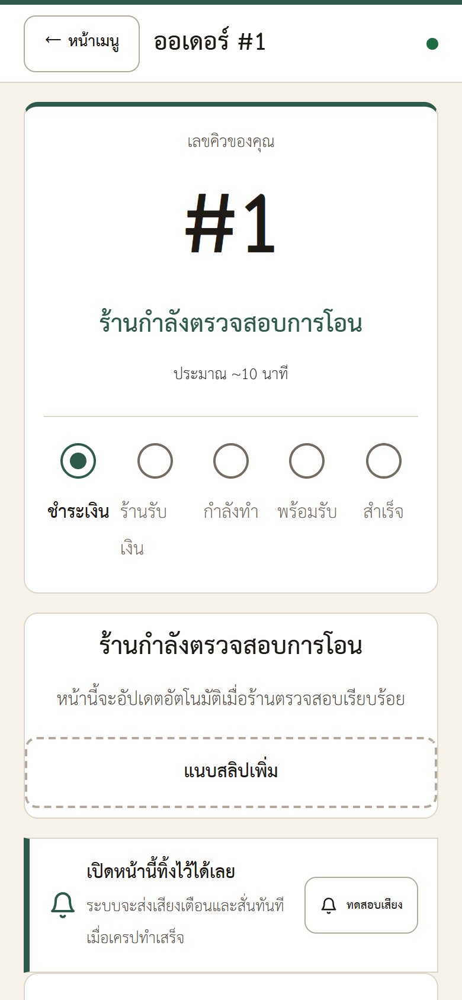
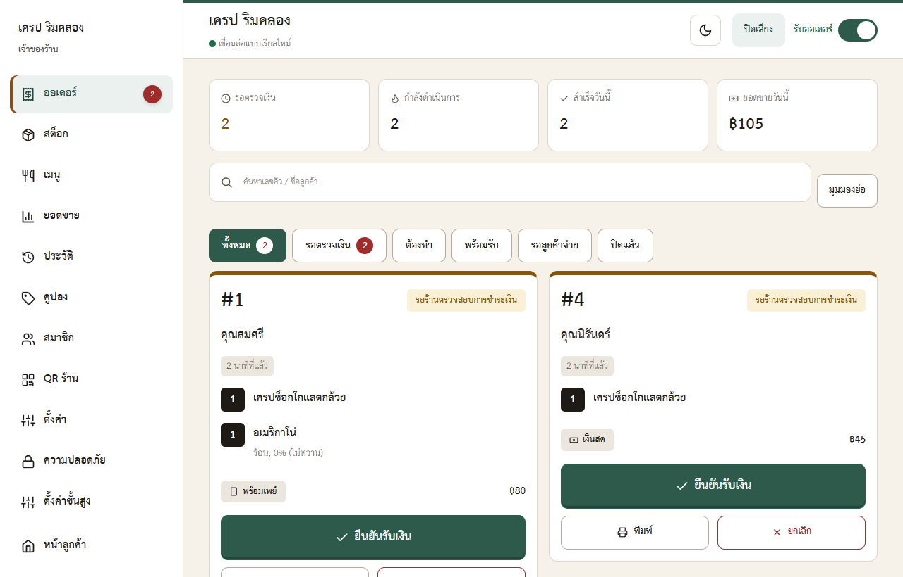
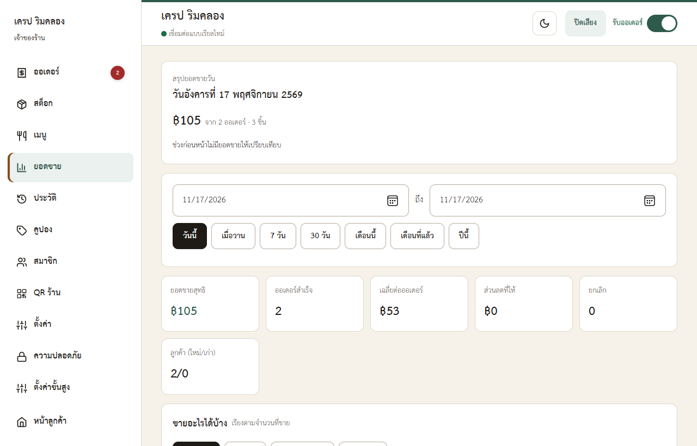
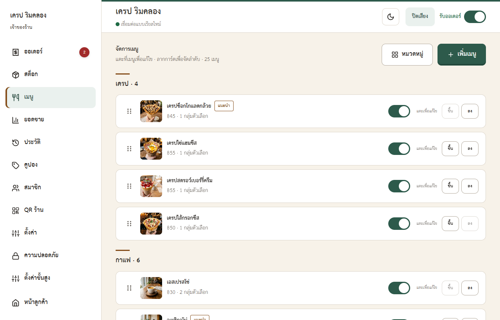

# เครป ริมคลอง — ระบบสั่งเครปและเครื่องดื่มผ่าน QR

ลูกค้าสแกน QR ที่ร้าน แล้วสั่งผ่านมือถือได้เลย ร้านได้รับออเดอร์แบบเรียลไทม์พร้อมเสียงเตือนและการ์ดแจ้งเตือน LINE ลูกค้าชำระด้วยพร้อมเพย์หรือเงินสด เจ้าของร้านกดยืนยันทุกขั้นตอน

ทำสำหรับร้านเครปเล็กๆ ที่หมู่บ้านเจษฎา 7 ต.ลำไทร อ.วังน้อย จ.พระนครศรีอยุธยา ออกแบบให้ใช้ง่ายสำหรับทั้งลูกค้าและคนอายุมาก (ตัวหนังสือใหญ่ ปุ่มใหญ่ สีเรียบ)

**Stack:** Node.js (Express + WebSocket) + HTML/CSS/JavaScript ล้วน เก็บข้อมูลเป็นไฟล์ JSON ในโฟลเดอร์ `data/` ไม่ต้องใช้ฐานข้อมูล

---

## ภาพหน้าจอ

ภาพด้านล่างแคปจากระบบที่รันจริงด้วยข้อมูลทดสอบ (ชื่อลูกค้าและออเดอร์เป็นข้อมูลสมมติ)

### ฝั่งลูกค้า (มือถือ)

| เมนู | เลือกตัวเลือก | ตะกร้า | ติดตามสถานะ |
|---|---|---|---|
|  |  |  |  |

### ฝั่งหลังร้าน (เจ้าของ/พนักงาน)

**ออเดอร์เข้าแบบเรียลไทม์**



**รายงานยอดขาย**



**จัดการเมนู (ใส่รูป ราคา ตัวเลือก เปิด/ปิดขาย)**



---

## ฟีเจอร์

**ลูกค้า**
- ล็อกอินด้วย Google (สมาชิก สะสมแต้ม) หรือสั่งแบบแขก
- ค้นหาเมนู แบ่งหมวด เมนูแนะนำ รูปและคำอธิบาย
- เลือกตัวเลือก: ท็อปปิ้ง (จำกัดจำนวนได้) ขนาด ความหวาน รูปแบบ ร้อน/เย็น/ปั่น หมายเหตุ
- ตะกร้า คูปอง ใช้แต้มเป็นส่วนลด
- จ่ายพร้อมเพย์ (QR ตามยอด แนบสลิปได้) หรือเงินสด
- ติดตามสถานะแบบเรียลไทม์ พร้อมเสียงเตือนเมื่อพร้อมรับ
- ประวัติการสั่งและสั่งซ้ำ รองรับโหมดมืด ติดตั้งลงหน้าจอมือถือได้ (PWA)

**เจ้าของ/พนักงาน**
- ออเดอร์เข้าพร้อมเสียงเรียก เสียงพูดภาษาไทย (ยอดเงิน หมายเลขคิว) และการ์ดแจ้งเตือน LINE
- ยืนยันรับเงิน → เริ่มทำ → พร้อมรับ → สำเร็จ หรือปฏิเสธพร้อมเหตุผล ดูสลิป พิมพ์ใบออเดอร์
- ปรับสต็อก เปิด/ปิดเมนู เปิด/ปิดรับออเดอร์ได้ทันที
- จอคิวสำหรับตั้งหน้าร้าน (`/queue.html`)

**เฉพาะเจ้าของ**
- แก้เมนูแบบฟอร์ม หมวดหมู่ กลุ่มตัวเลือก อัปโหลดรูปสินค้า
- คูปอง (บาท/เปอร์เซ็นต์ ขั้นต่ำ เพดาน หมดอายุ)
- รายงานยอดขาย: ขายอะไรได้บ้าง แยกหมวด รายวัน/ชั่วโมงขายดี ช่องทางชำระเงิน ส่งออก CSV
- สมาชิกและแต้ม ตั้งค่าร้าน เวลาเปิด-ปิด วันหยุด ข้อมูลติดต่อ
- ความปลอดภัย: บันทึกการใช้งาน แบนผู้ใช้ จำกัดออเดอร์ สำรองและตรวจความถูกต้องของข้อมูล

**ระบบ**
- คำนวณราคาฝั่งเซิร์ฟเวอร์เสมอ (แก้ราคาจากฝั่งลูกค้าไม่ได้)
- ตัด/คืนสต็อกอัตโนมัติ ยกเลิกออเดอร์ที่ไม่จ่ายเมื่อหมดเวลา
- กันสั่งซ้ำ จำกัดจำนวนครั้ง (rate limit) ป้องกันการกลั่นแกล้ง
- เขียนไฟล์แบบปลอดภัย (atomic write) สำรองไฟล์อัตโนมัติ กู้คืนเมื่อไฟล์เสีย

### สถานะออเดอร์

`รอชำระเงิน` → `รอร้านตรวจสอบ` → `ยืนยันรับเงิน` → `กำลังทำ` → `พร้อมรับ` → `สำเร็จ`

---

## เริ่มใช้งาน

ต้องมี [Node.js](https://nodejs.org) 20 ขึ้นไป

```bash
npm install
cp .env.example .env     # แล้วแก้ค่าใน .env
npm start
```

บน Windows ดับเบิลคลิก `start-server.bat` ก็ได้

| หน้า | ลิงก์ |
|---|---|
| ลูกค้า | http://localhost:3000 |
| หลังร้าน | http://localhost:3000/admin.html |
| จอคิวหน้าร้าน | http://localhost:3000/queue.html |

ถ้ายังไม่ตั้ง `GOOGLE_CLIENT_ID` ระบบจะเข้าโหมดทดสอบ (ล็อกอินจำลอง) **ห้ามใช้โหมดนี้ตอนเปิดขายจริง**

## ตั้งค่า (ไฟล์ `.env`)

| ตัวแปร | ความหมาย |
|---|---|
| `PORT` | พอร์ตเซิร์ฟเวอร์ (ค่าเริ่มต้น 3000) |
| `SHOP_NAME`, `PROMPTPAY_ID` | ค่าเริ่มต้นครั้งแรก หลังจากนั้นแก้ในหน้าตั้งค่า |
| `ADMIN_EMAILS` | อีเมล Google ของเจ้าของร้าน คั่นด้วย `,` |
| `GOOGLE_CLIENT_ID` | OAuth Client ID สำหรับล็อกอิน Google |
| `TRUST_PROXY` | ตั้งเป็น `1` เมื่ออยู่หลัง proxy หรือ tunnel |
| `DATA_DIR` | โฟลเดอร์เก็บข้อมูล (ค่าเริ่มต้น `./data`) |

**อย่าอัปโหลด `.env` และโฟลเดอร์ `data/` ขึ้นที่สาธารณะ** ในนั้นมีโทเคน LINE ข้อมูลลูกค้า ออเดอร์ และสลิป (ถูกกันไว้ใน `.gitignore` แล้ว)

### ตั้งค่า Google Login
1. [Google Cloud Console](https://console.cloud.google.com) → APIs & Services → Credentials → สร้าง OAuth client ID (Web application)
2. Authorized JavaScript origins: โดเมน https ของร้าน (และ `http://localhost:3000` ถ้าจะทดสอบในเครื่อง)
3. ใส่ Client ID ใน `.env` แล้วรันเซิร์ฟเวอร์ใหม่

### การ์ดแจ้งเตือน LINE (ไม่บังคับ)
สร้าง LINE Official Account และ Messaging API แล้วใส่ Channel Access Token / Channel Secret ในหน้า หลังร้าน → ตั้งค่า ตั้ง Webhook URL เป็น `https://โดเมนของคุณ/webhook/line` จากนั้นกดปุ่มทดสอบในหน้าตั้งค่า

## เปิดให้ลูกค้าสั่งผ่านอินเทอร์เน็ต

Google Login ต้องใช้ https บนโดเมนจริง ทางเลือกที่ใช้อยู่:

- **Cloudflare Tunnel** รันจากเครื่องที่ร้าน (ฟรี ใช้โดเมนของตัวเอง) ดูไฟล์ `start-online.bat` และ [ONLINE_PLAN.md](ONLINE_PLAN.md)
- **เซิร์ฟเวอร์เช่า (VM)** มีสคริปต์ตั้งค่าเริ่มต้นใน `deploy/` (`pos.service`, `setup-vm.sh`, `backup.sh`) ยังไม่ได้ทดสอบบนเซิร์ฟเวอร์จริง
- ถ้าใช้ Render/Railway ต้องมี persistent disk และชี้ `DATA_DIR` ไปที่ disk นั้น ไม่เช่นนั้นข้อมูลหายเมื่อ deploy ใหม่

จากนั้นสร้าง QR ร้านในหน้า หลังร้าน → QR ร้าน แล้วพิมพ์ไปติดหน้าร้าน

## ข้อจำกัดที่ควรรู้

- **ไม่ตรวจยอดโอนอัตโนมัติ** พร้อมเพย์ส่วนบุคคลไม่มี API เจ้าของร้านต้องดูสลิปหรือแอปธนาคาร แล้วกดยืนยันเอง
- **เก็บข้อมูลเป็นไฟล์ JSON** เหมาะกับร้านเดียวที่ออเดอร์ไม่หนาแน่น ควรสำรองข้อมูลนอกเครื่องเป็นประจำ
- **เสียงแจ้งเตือนต้องเปิดหน้าหลังร้านค้างไว้** และต้องแตะหน้าจอหนึ่งครั้งหลังโหลดหน้า เพราะเบราว์เซอร์บังคับ ถ้าจอดับหรือแท็บอยู่เบื้องหลังอาจพลาดเสียงได้
- เสียงพูดภาษาไทยขึ้นกับเสียงที่ติดตั้งในอุปกรณ์ (Edge มีเสียงไทยคุณภาพดีกว่า)
- ระบบเหมาะกับร้านเดียว ไม่รองรับหลายสาขา

## โครงสร้างโปรเจกต์

```
server.js         API, ล็อกอิน, WebSocket, ตรรกะออเดอร์
ops.js            ความปลอดภัย บันทึกการใช้งาน สำรองข้อมูล รายงานยอดขาย
line-oa.js        แจ้งเตือนและ webhook ของ LINE
default-menu.js   เมนูเริ่มต้นเมื่อยังไม่มีข้อมูล
public/           หน้าเว็บทั้งหมด (index, order, admin, queue, common.js, style.css)
data/             ข้อมูลจริงของร้าน (ไม่อยู่ใน git)
deploy/           สคริปต์ติดตั้งบนเซิร์ฟเวอร์
tests/            ตัวช่วยตรวจหน้าตาและการเข้าถึง
video/            คลิปแนะนำร้านและต้นฉบับ
docs/screenshots/ ภาพหน้าจอใน README
```

## เอกสารอื่น

- [OPERATIONS.md](OPERATIONS.md) คู่มือใช้งานจริง ความปลอดภัย เสียงแจ้งเตือน สำรองข้อมูล
- [ONLINE_PLAN.md](ONLINE_PLAN.md) การนำระบบขึ้นออนไลน์
- [ANTI_PLAN.md](ANTI_PLAN.md) รายการบั๊กและงานที่ค้าง
